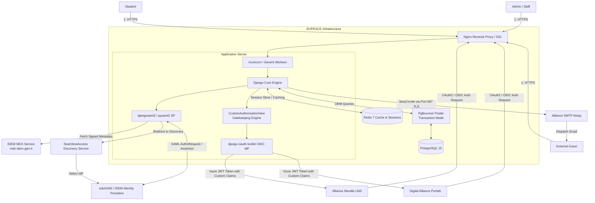
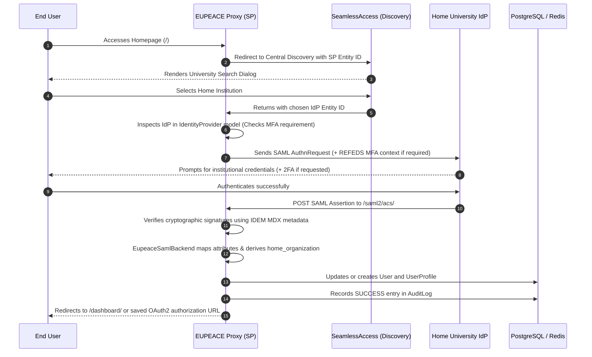
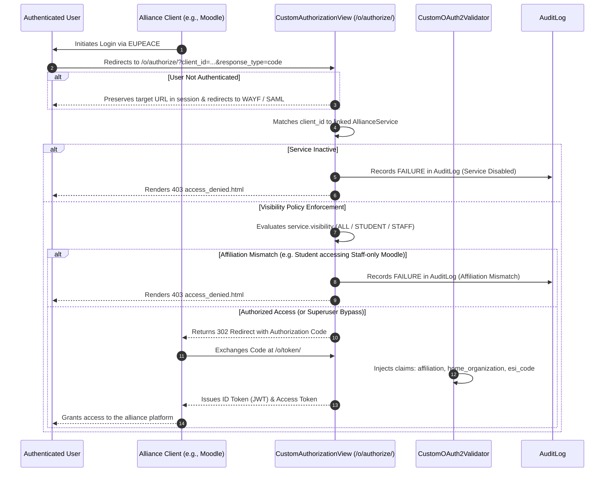
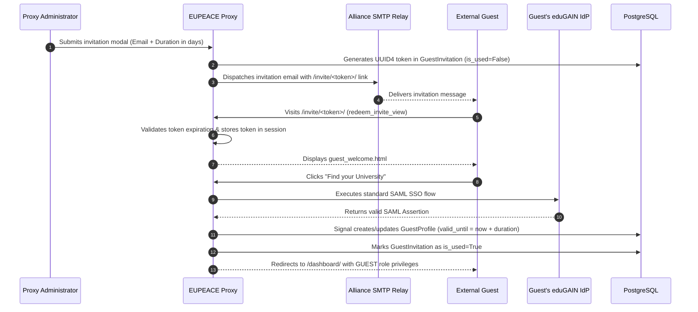
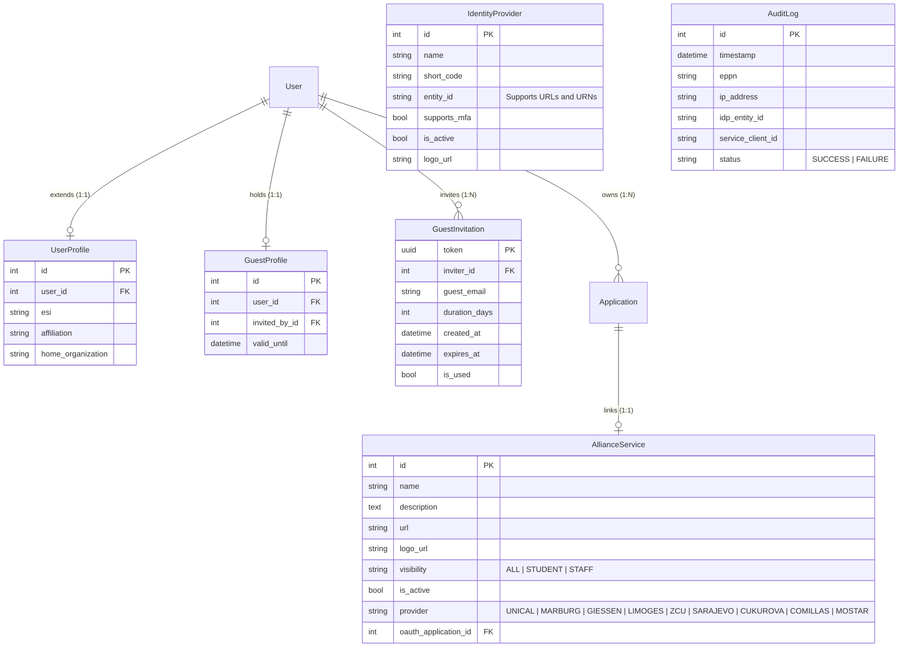

# 🏗 Architecture & Design Specifications

The **EUPEACE Proxy Identifier** is a hybrid Identity and Access Management (IAM) node designed to bridge federated university identities with internal and external digital alliance services.

The platform simultaneously operates in two fundamental roles:
1. **Inbound SAML 2.0 Service Provider (SP):** Accepts authentication assertions from federated Identity Providers (IdPs) belonging to the **IDEM GARR** and **eduGAIN** confederations.
2. **Outbound OAuth2 / OpenID Connect (OIDC) Identity Provider (IdP):** Issues digitally signed OIDC tokens to alliance services (e.g., Moodle LMS instances, collaborative platforms) while strictly enforcing affiliation-based gatekeeping policies.

---

## 1. High-Level System Architecture

---

## 2. Sequence Diagrams

### A. Inbound Federated Authentication Flow (SAML 2.0 Single Sign-On)
The proxy delegates user authentication to their home university's Identity Provider, retrieving attributes and populating the local session:

---

### B. Outbound OAuth2 / OpenID Connect Gatekeeping Flow
When external alliance platforms (like Moodle) request user authorization, the proxy acts as an OIDC Identity Provider with strict role-based gatekeeping:

---

### C. Guest Invitation & Redemption Lifecycle
Enables external experts, researchers, and partners to be invited with time-limited access:

---

## 3. Data Architecture & Relational Schema

The data model is implemented in `core/models.py` and consists of six primary entities:

### Model Specifications

1. **`UserProfile`:**
   * One-to-one extension of Django's built-in `User` model.
   * Maps essential SAML attributes: European Student Identifier (`esi`), scoped affiliation (`affiliation`), and institutional domain (`home_organization`).
   * Provides the `formatted_esi` property, parsing SCHAC personal unique codes into user-friendly HTML tags.

2. **`GuestProfile`:**
   * One-to-one extension for users who authenticated through an invitation token.
   * Tracks the inviter reference (`invited_by`) and role expiration timestamp (`valid_until`).

3. **`GuestInvitation`:**
   * Manages pending and fulfilled invitation tokens.
   * Includes utility methods such as `is_valid()` to verify token freshness before redemption.

4. **`AllianceService`:**
   * Defines the catalog of alliance services presented on the dashboard.
   * Links to `oauth2_provider.Application` via a nullable `OneToOneField`. When linked, any OAuth2 authorization request for this client triggers gatekeeping enforcement.
   * Categorized by providing university (partner universities of the EUPeace alliance) and role visibility (`ALL`, `STUDENT`, `STAFF`).

5. **`IdentityProvider`:**
   * Maintains the active directory of federated Identity Providers.
   * `entity_id` is stored as `CharField(max_length=500)` to fully accommodate both standard URLs and URN-formatted identifiers (e.g., `urn:mace:cru.fr:federation:unilim.fr`).
   * Controls dynamic injection of the REFEDS MFA profile during SAML authentication requests.

6. **`AuditLog`:**
   * Immutable security audit log tracking all authentication events (`SUCCESS` / `FAILURE`), client IP addresses, user ePPNs, IdP entity IDs, and target client IDs.
   * Protected in Django admin against manual tampering or alteration (`has_add_permission=False`, `has_change_permission=False`).

---

## 4. Middleware, Session & Infrastructure Hardening

* **Session Storage:** Powered by Redis (`django_redis.cache.RedisCache`). User sessions reside in RAM to ensure high throughput and rapid SSO redirects.
* **PgBouncer Compatibility:** Set to `POOL_MODE=transaction` with `prepare_threshold: None` in database settings to support high concurrent connection volumes without resource exhaustion.
* **SAML RelayState Preservation:** To prevent IdPs from truncating OAuth2 authorization URLs (which often exceed the 80-byte SAML RelayState specification), the proxy captures the `next` parameter in the Redis session (`oauth2_next_url`) and restores it upon successful authentication.
* **Bfcache & Cache Prevention:** Sensitive authentication views and user dashboards are decorated with `@never_cache` to prohibit browser caching, preventing information leakage via browser back/forward buttons on shared workstations.
